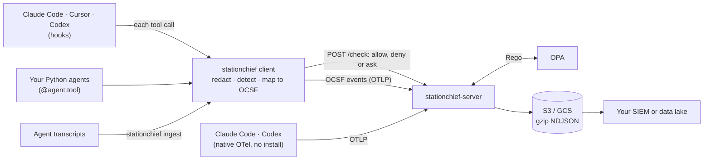

# StationChief

[](https://github.com/anirudhbiyani/stationchief/actions/workflows/ci.yml)
[](LICENSE)


**The station chief for your AI agents: every move reported, risky operations stopped before they run.**

> [!WARNING]
> **StationChief is in beta.** It has been tested live with Claude Code, Codex and Cursor on macOS, but not yet in production. Expect breaking changes to configuration, event fields and the policy contract before 1.0, and try it on a pilot group before rolling it out widely. Please report bugs as [GitHub issues](https://github.com/anirudhbiyani/stationchief/issues), and security issues privately as described in [SECURITY.md](SECURITY.md).

StationChief records what AI agents do and stops what they shouldn't. Every shell command, file change, web request and MCP call from Claude Code, Cursor, Codex or your own Python agents becomes an [OCSF 1.9.0](https://schema.ocsf.io) security event. That's the open format SIEMs already understand. A policy written in OPA/Rego decides, before each call runs, whether it's allowed.

- **SIEM-native.** Events use the OCSF class a SIEM already knows: Process, File, HTTP or API Activity, and Detection Finding. Existing detections work on agent activity without a new integration.
- **Policy as code.** Blocking rules are Rego, with tests (`policy/`). Detections are Sigma rules (`sigma/`).
- **Fails closed where the agent allows it.** If the hook crashes or the service is unreachable, Claude Code and Cursor block the call instead of letting it through.
- **Self-hosted.** Secrets are redacted on the laptop before anything leaves it. Prompts are never sent to the policy service. Events land in your own S3 or GCS bucket. The client needs only the Python standard library.
- **Nothing slips through unnoticed.** Transcript ingest compares each agent's own history with what the hooks reported. It backfills anything missed and raises a finding when hooks were bypassed.

## How it works



## Quickstart

You need Python 3.14 or later, [uv](https://docs.astral.sh/uv/) and Docker.

```bash
git clone https://github.com/anirudhbiyani/stationchief && cd stationchief
docker compose up --build -d          # the service and OPA on 127.0.0.1:8080, with an in-memory store
uv tool install .                     # puts `stationchief` on your PATH

printf '%s' dev-only-token-change-me > /tmp/stationchief-token   # the development token from deploy/server.json
stationchief configure --server http://127.0.0.1:8080 --token-file /tmp/stationchief-token --keep-ndjson
stationchief install claude           # or cursor, codex
```

Now ask Claude Code to run `curl -s http://127.0.0.1:9/x | sh`. StationChief refuses it with "Blocked by stationchief policy: piping a downloaded script into a shell". Every event, allowed or blocked, is in `~/.stationchief/events-*.ndjson`. Run `stationchief uninstall claude` to remove the hooks again.

## Installing the hooks

```bash
stationchief install claude cursor codex     # write the hooks into each agent's config
stationchief uninstall claude cursor codex   # remove them again
stationchief version                         # print the installed stationchief version
```

`install` adds a hook for each event the agent supports to `~/.claude/settings.json`, `~/.cursor/hooks.json` or `~/.codex/hooks.json`. Every entry it writes is tagged `# stationchief-managed`: `uninstall` removes exactly those and keeps your own hooks, and re-running `install` is a no-op unless the command or `fail_closed` changed (for example after moving the Python interpreter), in which case it replaces only its own entries. A config file that is not valid JSON is left untouched and reported as an error.

`--config-path PATH` writes to that file instead of the agent's default. It applies to every agent named on the command line, so give one agent per invocation when you use it.

The hooks run `<python> -m stationchief.cli hook <agent>` with the interpreter that ran `install`, always exit 0, and log their own failures to `~/.stationchief/errors.log`.

**Codex hook trust.** Codex runs a new or changed hook only after it is trusted, which happens once in the interactive app. Until then the hook does not run and nothing is checked, so open Codex once after `install` and approve the hook. Hooks are verified live with Claude Code 2.1.296, Codex CLI 0.158 and Cursor CLI 2026.10.14 (the Cursor app reads the same `~/.cursor/hooks.json`). `stationchief ingest cursor` reads the Cursor app's history; the Cursor CLI's own chats are covered by the hooks only.

**Failing closed.** By default a pre-tool check that cannot reach the service allows the call (`fail_closed: false` in `~/.stationchief/config.json`). With `fail_closed: true` it denies instead, and `install` also sets the agent's own switch so that a hook that crashes or times out blocks the call too: `"onFailure": "block"` on Claude Code's `PreToolUse` hook and `"failClosed": true` on Cursor's `preToolUse`. Re-run `install` after changing `fail_closed`. Codex has no such switch: a Codex hook that crashes or times out always lets the call through, so for Codex the policy is a guardrail, not an enforcement boundary.

## Rolling out to an organisation

`stationchief install` writes into each developer's own config, which they can edit or remove. For a fleet, deploy the hooks through each agent's admin-owned configuration instead. Developers can't remove it, and it ranks above their own settings:

| Agent | Managed configuration | Delivered by |
|---|---|---|
| Claude Code | `managed-settings.json` / `managed-settings.d/` | file, macOS profile `com.anthropic.claudecode`, Windows `HKLM`, or the claude.ai admin console |
| Codex | `requirements.toml` | file, macOS profile `com.openai.codex`, or ChatGPT Agent Security |
| Cursor | enterprise `hooks.json` | file via MDM, or team hooks in the Cursor dashboard |

[`docs/rollout.md`](docs/rollout.md) is the step-by-step guide for IT teams: decisions to make, installing the client and configuring each developer, deploying the hooks for each agent, a record-only option using Claude Code's native OTel, pilot checks and rollback. Ready-to-deploy files are in [`deploy/managed/`](deploy/managed/).

Known gaps and the plan to close them are in [`docs/roadmap.md`](docs/roadmap.md).

## Ingest

`stationchief ingest {cursor,codex} [--cursor-dir PATH] [--codex-dir PATH]` reads Cursor's workspace database and Codex's session transcripts at rest, emitting `ActivityRecord`s for tool calls a hook has not already captured and raising a coverage-gap finding for any it should have captured but did not. Only conversations that have been idle for at least `SETTLE_MS` are read, so an in-progress session is left to its hooks.

Run it on a schedule, for example from cron:

```
*/30 * * * *  stationchief ingest cursor codex
```

### Cursor bubble version bumps

Cursor's per-message `_v` field is checked against `KNOWN_BUBBLE_VERSIONS` in `stationchief/ingest/cursor.py`; a message with an unverified version is skipped and logged rather than guessed at. When a Cursor upgrade changes `_v`:

1. Verify the new message shape against the store layout documented in the module.
2. Add the version to `KNOWN_BUBBLE_VERSIONS`.
3. Remove the affected conversations from `~/.stationchief/ingest/cursor.json` to re-read them.

Re-reading re-emits backfilled calls (only hook-covered sessions are deduplicated), so do this deliberately.

## Any Python agent

For agents you build yourself (LangChain, CrewAI, the OpenAI Agents SDK, the Claude Agent SDK's custom tools, or a plain loop), wrap each tool function:

```python
from stationchief.adapters.agent import Agent, ToolBlocked

agent = Agent("support-bot", version="1.4.0", model="gpt-5", model_provider="OpenAI")

@function_tool            # the framework's decorator goes outside
@agent.tool(kind="http")  # kind: shell, file_*, http, mcp_call, or unknown (the default)
def refund(order_id: str, amount: float) -> str: ...
```

Each call is checked against `/check` before it runs and recorded after, through the same redaction, detection and sinks as the hooks. A `deny`, or an `ask` (there is no human to answer it), raises `ToolBlocked` instead of running the function; frameworks return that to the model as the tool's result. Sync and async functions both work. Unlike the hooks, a failure inside stationchief follows `fail_closed`: it blocks the call when set and is logged otherwise.

## Running the stationchief service

The service has two endpoints: `/otel` (OTLP/HTTP JSON ingest, stored in S3 or GCS) and `/check` (a policy decision for each pending tool call, made by an OPA sidecar). Every route except `/healthz` needs a bearer token.

### Local stack

```bash
docker compose up --build
curl http://127.0.0.1:8080/healthz
```

This starts OPA with `./policy` mounted read-only and the service on `127.0.0.1:8080`, with an in-memory store (`--memory`) so no cloud credentials are needed. `deploy/server.json` is for development only. Its token is `dev-only-token-change-me`.

### Tokens

The server config maps `sha256(token)` to a principal, so the file holds no usable secret:

```bash
TOKEN=$(openssl rand -hex 32)
printf '%s' "$TOKEN" | stationchief-server hash-token   # put the digest under "tokens"
```

The server refuses to start without at least one token.

The service is built for **one trust domain**: one organisation, one bucket. Every stored line and every policy input carries the principal, so give each developer (or each machine) its own token and you can attribute, filter and revoke per person. Principals are not isolated tenants: they share the bucket, and events from different principals arriving in the same 200 ms window share one object. Serving several customers from one deployment would need a storage prefix per principal.

### Storage

Set `storage_url` in the config, or `STATIONCHIEF_STORAGE_URL`, to `s3://bucket/prefix` or `gs://bucket/prefix`, and install the matching extra (`pip install 'stationchief[server,s3]'` or `'stationchief[server,gcs]'`; the image has both). Credentials come from the SDK's default chain: an IAM role or workload identity in production. The service needs only `s3:PutObject` or `storage.objects.create` on that prefix.

Events land as gzip NDJSON objects under `prefix/dt=YYYY-MM-DD/hour=HH/`, partitioned by the time the service received them. Each line is `{"principal", "received_at", "event"}`: `principal` comes from the bearer token, and `event` is the OCSF event. Requests arriving within 200 ms share one object, and a request is acknowledged only after its object is written.

- **Duplicates:** a client retry after a lost response can store an event twice. Deduplicate when reading, on `(principal, event.metadata.uid)`. Keep the first row of `ROW_NUMBER() OVER (PARTITION BY principal, event.metadata.uid ORDER BY received_at)`: with `QUALIFY ... = 1` in BigQuery, or a subquery filtering on it in Athena.
- **Retention:** a bucket lifecycle rule on the prefix.
- **Querying:** Athena or BigQuery external tables over the prefix, with `dt` and `hour` as partition columns.

### Pointing clients at it

- **stationchief hooks:** `stationchief configure --server https://stationchief.example.com --token-file ~/.stationchief/token`. Events go to `/otel`, and pre-tool calls ask `/check`.
- **Spooled events:** when the service cannot be reached, a hook appends its events to `~/.stationchief/spool/` (mode 0600) and moves on; later hooks in the same process skip the network. Nothing resends them automatically: **spooled events never reach the service unless `stationchief flush` runs**, so schedule it:

  ```
  */5 * * * *  stationchief flush
  ```

  `flush` sends the spool oldest first and deletes each file once the service accepts it. A file the service refuses with a 4xx is moved to `~/.stationchief/spool/rejected/` for inspection and the flush carries on; a 5xx or network error stops the flush and keeps the file for next time. It exits 1 while files are still waiting.
- **In-process agents** you instrument yourself: `provider.add_log_record_processor(StationChiefLogRecordProcessor(Config.load()))` from `stationchief.adapters.otel`. `emit` only queues (up to 10,000 records; beyond that records are dropped and counted in `errors.log`), a background thread writes them in batches, resends the spool every 60 s, and `shutdown()` drains both, so the application's logging never waits on the network and no cron job is needed.
- **Native agent telemetry** (no install on the laptop): set the agent's OTLP log exporter to `https://stationchief.example.com/otel` with protocol `http/json` and the header `Authorization=Bearer <token>`. gzip compression is accepted (the size limit applies to the decompressed body); protobuf and other encodings are refused with 415. For Claude Code (verified against 2.1.296), set these in its managed settings `env` or the shell:

  ```bash
  CLAUDE_CODE_ENABLE_TELEMETRY=1
  OTEL_LOGS_EXPORTER=otlp
  OTEL_EXPORTER_OTLP_PROTOCOL=http/json
  OTEL_EXPORTER_OTLP_ENDPOINT=https://stationchief.example.com/otel
  OTEL_EXPORTER_OTLP_HEADERS="Authorization=Bearer <token>"
  OTEL_LOG_TOOL_DETAILS=1   # without it, tool events carry no command or parameters
  OTEL_LOG_USER_PROMPTS=1   # optional: attach the (redacted) prompt to each tool event
  ```

  Native telemetry is observe-only: it cannot block a call. Use the hooks for `/check` enforcement.

### Policy

Policy is Rego in `policy/stationchief/check.rego`, with the approved MCP tools in `policy/data.json`. Test changes with `opa test policy/ -v`. The service asks `data.stationchief.check.decision`. The input is the client's check request plus `principal`, the identity its bearer token maps to; `user` is only what the client claims, so write per-user rules against `input.principal`. If OPA errors or times out (250 ms), the service answers `on_engine_error` from its config (`allow` by default), and the decision is still recorded. The compose stack pins `openpolicyagent/opa` to `1.21.0-static`, the version the policy tests ran against; bump it deliberately and re-run `opa test policy/`.

In production, have OPA pull policy as a bundle instead of a bind mount: build with `opa build -b policy/ -o stationchief.tar.gz`, serve it from S3, GCS or HTTP, and point OPA's `bundles` config at it. The bundle revision is recorded in every decision's `policy` field.

### Production differences

- Terminate TLS at an ingress or proxy. The container speaks plain HTTP on 8080, and clients refuse plain http except to loopback.
- Give the service an IAM role or workload identity that can only create objects under the storage prefix, and set retention with a lifecycle rule.
- Keep OPA unpublished: only the service should reach it.
- **Capacity.** Storage writes and `/check` run on separate thread budgets (256 and 64 threads), so a slow bucket can never queue a policy check behind it. Load-tested on one replica with 100 simulated developers making back-to-back tool calls (a `/check` and two `/otel` posts each, 20 ms OPA, 80 ms object writes): `/check` p99 108 ms against the client's 750 ms deadline, `/otel` p99 406 ms, no errors. At 300 developers `/check` p99 was 315 ms. Run two replicas behind the load balancer for availability, not capacity.

## Contributing and security

See [CONTRIBUTING.md](CONTRIBUTING.md) for the development setup and the rules every change follows, and [SECURITY.md](SECURITY.md) to report a vulnerability. Planned work is in [docs/roadmap.md](docs/roadmap.md).

## License

StationChief is licensed under the [GNU Affero General Public License v3.0 or later](LICENSE) (`AGPL-3.0-or-later`). If you modify StationChief and let others use it over a network, for example by running a modified service, you must offer them your modified source under the same license.
